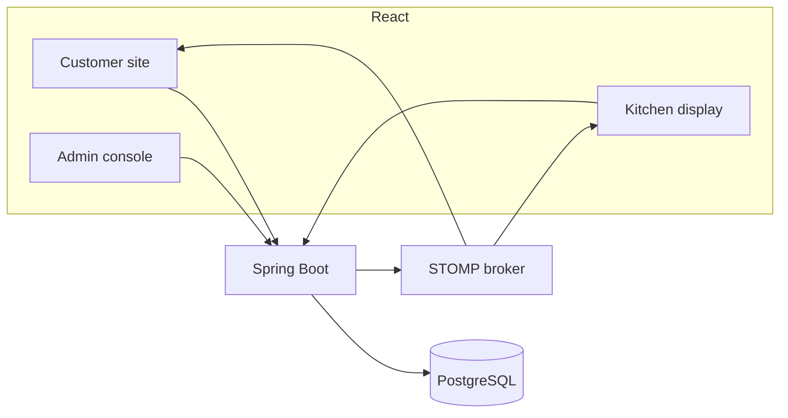
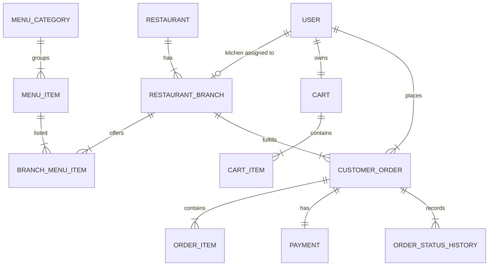
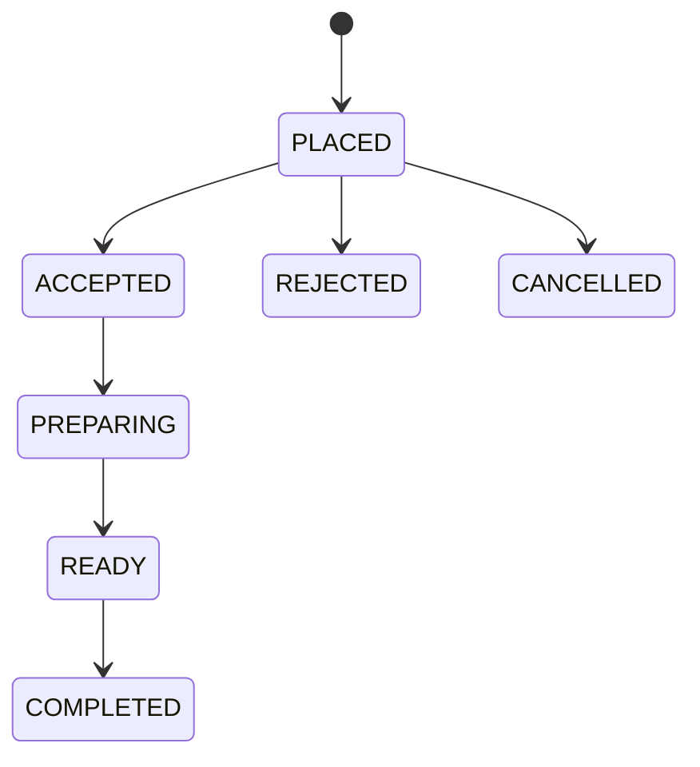

**GitHub Repository:** https://github.com/sanju-rana/Hearthline

**Live Application:** Not deployed yet.

# Technical Design Document

## 1. Project title

Hearthline: a restaurant chain's direct ordering website with a kitchen display.

## 2. Problem statement

The visible assignment title is "Restaurant chain's direct ordering website with kitchen display". The original detailed core-build paragraph was not available when this design was written. The product is therefore built around a working customer order path and a working kitchen display, using the technology stack required for the assignment.

## 3. Project overview

Hearthline is one fictional brand with several branches. A customer picks one branch, orders from that branch's menu, pays through a demo checkout, and tracks the order. Kitchen staff at that branch accept the ticket and move it through a fixed set of statuses. An administrator manages branches, the menu, and can read orders. One Spring Boot application owns the rules. PostgreSQL stores them. The React app is three experiences over the same API.

## 4. Confirmed requirements

- Java, Spring Boot 3, Spring Web, Spring Data JPA, Hibernate, Spring Security, validation, Actuator, WebSocket, JWT, Maven, JUnit 5, Mockito, and MockMvc.
- React, Vite, TypeScript, Tailwind, React Router, Axios, Context, React Hook Form, Zod, Lucide, and a STOMP client. Recharts is used for the admin status chart because those counts come from the database.
- PostgreSQL, foreign keys, unique constraints, indexes, transactions, and Flyway.
- Customer, kitchen, and admin experiences with role checks.
- Multiple branches, and one order cannot mix branches.
- Menu data from the database, with search, category, price sort, and availability.
- Server-side prices, tax, delivery fee, and total.
- Duplicate-submit protection.
- A payment flow that does not store card data. No provider credentials were available, so the gateway is an explicit demo.
- Kitchen status rules enforced in Java, real-time updates after commit, and a REST reload if the socket drops.
- Admin numbers from queries, not hard-coded charts.
- Docker Compose, README, this document, and `deployment.md`.

## 5. Assumptions and limitations

- The brand name Hearthline was chosen because no name was supplied.
- There is one chain. There is no super-admin and no second brand.
- Java 21 with Spring Boot 3.5.16. Java 21 is the long-term release that this Boot line supports.
- Currency is INR. Tax is 5 percent. Delivery is a flat 40. Pickup has no delivery fee. These values live in `application.yml`. This is not a tax engine.
- Each user has one role. Public registration creates customers. An admin endpoint creates kitchen staff for one branch.
- The cart is stored in PostgreSQL, one cart per customer. Changing branch clears the lines.
- The chain has one price list. Each branch has an available or unavailable flag. There is no stock counter.
- Opening hours are displayed. The `accepting_orders` flag is what blocks checkout. The clock does not auto-close a branch.
- A customer can cancel only while the order is `PLACED`. The kitchen can reject only from `PLACED`.
- A declined or pending demo payment does not create an order.
- Cancelling or rejecting a paid demo order marks the payment `CANCELLED` and tells the user that no money moved.
- Estimated preparation time is `15 + 2 minutes per item`, capped at 45. The UI calls it an estimate.
- Addresses are copied onto the order. There is no address book.
- Food images are URL strings, including Unsplash URLs in the seed data. There is no file-upload service.
- "Today" on the admin dashboard uses `Asia/Kolkata`.

## 6. Technology stack

| Layer | Choice | Why |
| --- | --- | --- |
| API | Spring Boot 3.5.16 | Required Boot 3 line. 3.5.16 is the current 3.5 release and runs on Java 21. |
| Security | Spring Security + JJWT | Cookie JWT is validated on each request and the user is reloaded so a logout can invalidate it. |
| Data | Spring Data JPA, Hibernate, Flyway, PostgreSQL 16 | Schema changes are SQL. Hibernate only validates that the entities match. |
| Real time | Spring STOMP over SockJS | Matches the required WebSocket stack and the browser client. |
| UI | React, Vite, TypeScript, Tailwind | One codebase for three experiences, with types shared with the API responses. |
| Run | Docker Compose | One command starts the database, API, and website in the right order. |

## 7. Architecture diagram



## 8. Why this shape

A modular monolith is enough. Controllers do not calculate money or decide the next status. Services do that inside a transaction. Repositories only query. DTOs leave the API, not JPA entities. A second service for the kitchen would add a network hop without a requirement.

The browser is treated as untrusted. Order placement reads the cart and the menu prices from PostgreSQL. The place-order body has no price field.

## 9. Frontend architecture

`frontend/src/api.ts` is the only place that knows URLs. `AuthContext` loads `/api/auth/me` on startup because the token is an HTTP-only cookie the JavaScript cannot read. `CartContext` loads the cart for customers. Pages under `pages` are the customer flow. `kitchen/KitchenPage.tsx` is the display. `admin/AdminPages.tsx` is the console. Protected routes check the role in the client, and the API checks it again.

Vite proxies `/api` and `/ws` to port 8080 during development. Nginx does the same in Docker. That keeps the cookie on one origin.

## 10. Backend architecture

Package `com.restaurant`:

| Package | Responsibility |
| --- | --- |
| `controller` | HTTP in and out. |
| `service` | Rules: auth, catalog, cart, orders, kitchen, admin, pricing, status machine, demo payment. |
| `repository` | Spring Data queries. |
| `entity` | Tables. |
| `dto` | Request and response records. |
| `security` | JWT, cookie, filter. |
| `websocket` | Handshake, subscription check, after-commit events. |
| `exception` | One JSON error shape. |
| `seed` | Dev-only sample data. |

`OrderService` is the class to walk through in an interview. It checks the idempotency key, locks the cart, re-reads availability and prices, calls `PaymentGateway`, saves the order, clears the cart, and registers the WebSocket event for after commit.

`OrderStatusMachine` is a small pure class so the legal moves can be unit-tested without a database. `OrderPricing` is the same idea for money.

## 11. Database ER diagram



## 12. Entities and relationships

- `users` holds the login, the BCrypt hash, one role, and `token_version`. Kitchen staff must have `branch_id`. Email is unique.
- `restaurants` is the brand. The seed creates one row.
- `restaurant_branches` holds the address, hours, `active`, and `accepting_orders`.
- `menu_categories` and `menu_items` are the shared catalog. Money is `numeric(10,2)`.
- `branch_menu_items` is unique on branch plus item. This is how one dish can be sold in Mumbai and hidden in Bengaluru.
- `carts` is unique per customer. `cart_items` quantities are between 1 and 20.
- `customer_orders` stores the contact snapshot, the address snapshot, the totals, the idempotency key, and a fingerprint of the checkout body. `order_items` copies the name and unit price.
- `payments` is one row per order. `provider` is `DEMO`. The reference is generated on the server.
- `order_status_history` stores every move, who made it, and when.

Indexes cover email, order number, the idempotency pair, branch plus status, and order lines. Order numbers come from `order_number_seq` and are shown as `HL-1001`.

## 13. API documentation

All responses:

```json
{ "success": true, "data": {}, "message": null, "timestamp": "..." }
```

Errors use `success: false`, a message, and optional field errors. Stack traces are logged, not returned.

| Method | Path | Access | Notes |
| --- | --- | --- | --- |
| POST | `/api/auth/register` | Public | Creates a customer and sets the cookie. |
| POST | `/api/auth/login` | Public | Sets the cookie. |
| POST | `/api/auth/logout` | Authenticated | Increments `token_version` and clears the cookie. |
| GET | `/api/auth/me` | Authenticated | Current user. |
| GET | `/api/restaurants` | Public | Active brands. |
| GET | `/api/restaurants/{id}` | Public | |
| GET | `/api/branches` | Public | Active branches. |
| GET | `/api/branches/{id}` | Public | |
| GET | `/api/branches/{branchId}/menu` | Public | `search`, `categoryId`, `sort`, `availableOnly`, `popularOnly`. |
| GET | `/api/menu/categories` | Public | |
| GET | `/api/menu/featured` | Public | Popular dishes for the landing page. |
| GET | `/api/menu/items/{id}?branchId=` | Public | Availability is for that branch. |
| GET | `/api/cart` | Customer | Totals are calculated on the server. |
| PUT | `/api/cart/branch` | Customer | Switching branch clears lines. |
| POST | `/api/cart/items` | Customer | |
| PUT | `/api/cart/items/{id}` | Customer | |
| DELETE | `/api/cart/items/{id}` | Customer | |
| DELETE | `/api/cart` | Customer | |
| POST | `/api/orders` | Customer | Header `Idempotency-Key`. Builds the order from the cart. |
| GET | `/api/orders/my` | Customer | Paged. |
| GET | `/api/orders/{id}` | Owning customer | |
| GET | `/api/orders/{id}/tracking` | Owning customer | Same payload, used by the live page. |
| POST | `/api/orders/{id}/cancel` | Owning customer | Only from `PLACED`. |
| GET | `/api/kitchen/orders` | Kitchen, own branch | Optional `status`. |
| GET | `/api/kitchen/orders/{id}` | Kitchen, own branch | |
| PATCH | `/api/kitchen/orders/{id}/status` | Kitchen, own branch | |
| GET | `/api/admin/dashboard` | Admin | |
| GET | `/api/admin/branches` | Admin | |
| POST | `/api/admin/branches` | Admin | Also offers every current dish at the new branch. |
| PUT | `/api/admin/branches/{id}` | Admin | |
| PATCH | `/api/admin/branches/{id}/operations` | Admin | Active and accepting flags. |
| GET | `/api/admin/categories` | Admin | |
| POST | `/api/admin/categories` | Admin | |
| PUT | `/api/admin/categories/{id}` | Admin | |
| GET | `/api/admin/menu` | Admin | Items plus per-branch availability. |
| POST | `/api/admin/menu/items` | Admin | Offered at every branch. |
| PUT | `/api/admin/menu/items/{id}` | Admin | |
| DELETE | `/api/admin/menu/items/{id}` | Admin | Deactivates. Sold items are not deleted. |
| PUT | `/api/admin/branches/{branchId}/menu/{itemId}` | Admin | Availability. |
| GET | `/api/admin/orders` | Admin | Filter by status, branch, order number. |
| GET | `/api/admin/orders/{id}` | Admin | Read only. No status shortcut. |
| POST | `/api/admin/staff` | Admin | Creates kitchen staff for a branch. |

WebSocket: connect to `/ws` with the same cookie. Subscribe to `/topic/kitchen/{branchId}` or `/topic/orders/{orderId}`. The server rejects a subscription the user does not own. Clients do not send status changes over the socket.

Validation failures are 400. Wrong role is 401 or 403. A missing row is 404. An illegal status, an unavailable item, or a reused idempotency key with a different body is 409. A declined demo payment is 402 and saves nothing.

## 14. Customer ordering workflow

1. The customer selects a branch. `PUT /api/cart/branch` stores it. A different branch clears the cart.
2. Adding a dish checks that the dish is active and available at that branch.
3. Checkout sends the contact fields, the order type, and `paymentOutcome`. It does not send prices.
4. `OrderService` locks the cart, re-checks the branch and every line, and prices the order with `OrderPricing`.
5. `DemoPaymentGateway` returns success, failure, or pending. Failure and pending throw before any insert.
6. The order, line snapshots, `DEMO` payment, and the first history row are saved. The cart lines are cleared.
7. After commit, the kitchen topic for that branch receives `ORDER_CREATED`.

The same idempotency key and the same body return the original order and do not charge again.

## 15. Kitchen workflow



`KitchenService` allows only the kitchen arrows. Cancel is a customer action. A kitchen user whose `branch_id` does not match the order receives 403. Reject and cancel mark a successful demo payment as cancelled.

## 16. Real-time workflow

`OrderEventPublisher.publishAfterCommit` registers a transaction synchronization. `afterCommit` sends the event to `/topic/kitchen/{branchId}` and `/topic/orders/{orderId}`. A rollback does not send it.

The React hook subscribes with SockJS and STOMP. On each event it reloads the order from REST, so the database remains the source of truth. If the socket is down, the kitchen and the tracking page poll every 15 seconds and show "Kitchen connection lost. Reconnecting...".

The handshake reads the JWT cookie. `SubscriptionGuard` checks the destination against the user before the broker delivers messages.

## 17. Authentication and authorization

Login verifies the email and the BCrypt hash, then puts a signed JWT in the cookie `hearthline_token`. The cookie is HTTP-only and `SameSite=Lax`. It is `Secure` only in the prod profile, because local HTTP would drop a secure cookie.

The JWT contains the user id, the role, and `token_version`. `JwtAuthenticationFilter` reads the cookie, reloads the user, and rejects the token when the version does not match. Logout increments the version, so a copied cookie stops working.

URL rules in `SecurityConfig` and `@PreAuthorize` on the controllers both apply. Branch ownership is checked in the service, because a role annotation cannot see which branch an order belongs to.

Passwords are never returned. Login failures use one message for a bad email and a bad password.

## 18. Payment workflow and its limitations

`PaymentGateway` is the seam. `DemoPaymentGateway` is the only implementation. It refuses to run unless `app.payment.mode` is `demo`. The stored provider is the string `DEMO`. The UI button says "Pay with demo checkout". A second button sends `FAILURE` so a reviewer can see a decline. Pending returns "Payment is still pending." and does not create a kitchen ticket.

This is not Razorpay, Stripe, or any other provider. No card number, CVV, or provider secret is collected or stored. A later class can implement `PaymentGateway` without changing `OrderService`.

Revenue on the dashboard sums `SUCCESS` payments whose orders are not `CANCELLED` or `REJECTED`.

## 19. UI decisions

The customer site uses a cream background, an ink color, and an ember accent, with Fraunces for headings and Outfit for text. The landing page loads featured dishes and categories from the API. Marketing copy such as "How ordering works" is static.

The kitchen screen uses a dark background, large order numbers, one action per lane, and a reject button only on new tickets. Sound is off until the cook turns it on, because browsers block audio until a gesture.

The admin screen is a sidebar plus tables and forms. The bar chart plots `ordersByStatus` from the dashboard query.

## 20. Error handling

`GlobalExceptionHandler` maps known failures to the messages the product needs, including "This menu item is currently unavailable.", "Payment was declined.", and "Payment is still pending." Unexpected exceptions become "Something went wrong. Please try again." The stack trace stays in the log.

The React `errorMessage` helper shows `response.data.message` and otherwise a fallback. Buttons that submit set a disabled state while the request is in flight.

## 21. Security measures

- BCrypt password hashes.
- JWT in an HTTP-only cookie, versioned so logout works.
- Role checks on the server.
- Customers can read only their orders.
- Kitchen staff can read and update only their branch.
- Admin routes are a separate matcher.
- Bean validation on request bodies.
- Totals recalculated from `menu_items.price`.
- CORS origins come from configuration and allow credentials.
- Secrets are environment variables. `.env` is gitignored. Dev defaults are marked as local-only.
- Database writes for an order happen in one transaction.
- WebSocket subscriptions are authorized.

CSRF is disabled because the API is stateless and the cookie is `SameSite=Lax` on a single proxied origin. A foreign site's form POST does not include that cookie. A production review would still add a CSRF token if the cookie were ever used across sites.

## 22. Testing strategy

Unit tests, without a database:

- Status machine, pricing, preparation estimate, password rule, idempotency fingerprint.
- `AuthServiceTest` for hashing, duplicate email, and a bad password. It uses a real BCrypt encoder.
- `DemoPaymentGatewayTest` for success, failure, pending, and the switch that disables simulated failure.
- `OrderServiceTest` for database pricing, unavailable items, the wrong branch, a bad quantity, an empty cart, a declined payment, a pending payment, and idempotency.
- `KitchenServiceTest` for a legal move, an illegal move, and another branch.
- `AuthControllerTest` uses MockMvc to reject an invalid registration body.

A full browser pass is described in `deployment.md`: register, order, kitchen update, customer tracking.

Testcontainers was considered for an end-to-end API test. The unit tests cover the rules without requiring the Docker engine to be running during `mvn test`. The schema itself is applied by Flyway when the API starts.

## 23. Sample data

`DevDataSeeder` runs only on the `dev` profile, and only when `admin@hearthline.test` is absent. It creates:

- Hearthline, with branches in Indiranagar, Bandra, and Connaught Place. Connaught Place is not accepting orders.
- Six categories and twenty dishes, mixed vegetarian and non-vegetarian.
- Branch-specific hidden dishes.
- The demo users in `deployment.md`.
- One completed order and one open delivery order at Indiranagar, so the dashboard and the kitchen are not empty.

## 24. Deployment architecture

`docker-compose.yml` starts PostgreSQL 16, the API image, and an nginx image that serves the React build and proxies `/api` and `/ws`. The API waits for Postgres health. Nginx waits for the API health check. Configuration is environment variables. Details and troubleshooting are in `deployment.md`.

## 25. Trade-offs

- A cookie plus a dev proxy is more setup than `localStorage`, and it avoids exposing the token to page scripts.
- Reloading the user on every request costs a query and makes logout real.
- Publishing after commit can miss a message if the process dies in that instant. The REST reload covers that. A message queue would be the next step, not the first.
- Boolean availability is easier to explain than a stock ledger and does not pretend to solve oversell races beyond the checkout transaction.
- Demo payment is honest. Hiding a simulator behind a fake provider name would be worse.

## 26. Deliberately excluded

Coupons, reviews, loyalty, email and SMS, live maps, distance-based delivery, stock counts, branch-specific prices, a real card form, file upload, and a second chain.

## 27. What I would build next

- A real `PaymentGateway` with server-side verification and webhooks.
- Refresh tokens with a shorter access-token life.
- A stock count with a row lock, if the kitchen needs to stop selling the last portion.
- An outbox table so a crash after commit still publishes the kitchen event.

## 28. Known limitations

- The demo gateway does not move money, and a cancel does not call a bank.
- Logout invalidates tokens only after the version check. A request already inside the filter is not revoked mid-flight.
- Kitchen history for a very busy branch is loaded as a list for the selected lane, not as an infinite scroll.
- Image URLs depend on the image host being reachable.
- The dev JWT default in `application.yml` is for a local database only. Production must set `JWT_SECRET`.
- This machine's default `java` command may still be Java 8 until `JAVA_HOME` points at JDK 21. See `deployment.md`.

## 29. GitHub repository URL

Not published yet. Push this project to a public repository and put the URL here and in the README before submission.

## 30. Live application URL

Not deployed to a public host. Local addresses after startup:

- Vite: http://localhost:5173
- Docker web: http://localhost:8088
- API: http://localhost:8080
